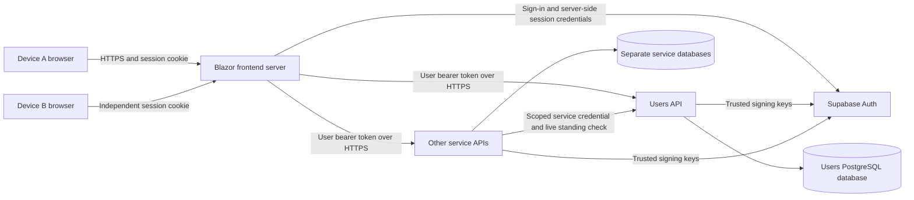

# Consolidated threat model

## Scope and status

This document addresses the Milestone 4 Security assignment: authentication,
authorization, configuration, profile data, private picture uploads and storage,
and device/session lifecycle. It records implemented controls separately from
remaining verification and operational risks. It is not a penetration-test
report or evidence of instructor or teammate approval.

Reviewed on 2026-11-23 against local branch `feature/public-nominatim`, revision
`d3c1c5a`. Later changes, particularly changes of identity provider, require review
of this model. The selected online identity provider is Supabase Auth; Auth0 is
an explicit compatibility path. Unmerged replacement authentication is outside
this assessment.

## Assets and trust boundaries

Protected assets include account identities, roles and standing; private profile
fields and pictures; private trips, settings and catalogue entries; passwords,
session cookies, access/refresh tokens and service credentials; database contents,
backups and administrative audit records.



The browser, every network call, each API and each database represent distinct
trust boundaries. Requests, files and client-supplied identity fields are
untrusted. The APIs establish identity from verified tokens, not from a browser's
claimed user ID. Each service owns its database; the frontend uses HTTP contracts.
Production uses HTTPS and verified database TLS. Loopback HTTP used for local
development is not evidence of secure deployed transport.

Assumptions: operators control deployment configuration and signing-key settings;
Supabase and database administrators are trusted; the access-token hook derives
scopes from administrator-controlled data; host machines and TLS trust stores are
not compromised. These assumptions need deployment verification.

## Threats, controls and residual risks

| ID / area | Threat and impact | Implemented mitigation and evidence | Residual risk or required follow-up |
| --- | --- | --- | --- |
| T01 Authentication | Forged, expired, unsigned or wrong-project tokens impersonate an account. | Shared [bearer validation](../src/TravelTracker.Security/Authentication/BearerAuthenticationExtensions.cs) checks signature, issuer, audience and lifetime, requires signed tokens and expiry, and restricts algorithms. [Supabase authentication tests](../tests/TravelTracker.Transport.Api.Tests/SupabaseAuthenticationTests.cs) and service authentication suites exercise real JWT validation with test keys. | Compromised signing keys or a stolen valid token remain dangerous. Verify deployed issuer, audience, algorithms, scope hook and key retrieval. |
| T02 Authorization | A valid user without permission invokes a protected mutation. | Explicit [scope policies](../src/TravelTracker.Security/Authentication/ScopePolicies.cs), documented [operation policy map](authentication.md#implemented-policy-map), and live standing/ownership checks. [Profile scope tests](../tests/TravelTracker.Users.Tests/UserProfileScopeMatrixTests.cs) assert permission boundaries. | A valid token must not replace ownership checks. Broad grants or a future endpoint with an incorrect policy can introduce privilege escalation. Review each new route. |
| T03 Profile ownership | Changing an ID or submitting owner/role fields exposes or modifies another account. | `/users/me` and picture operations derive the caller from the validated issuer/subject. [Users controller](../src/TravelTracker.Users.Api/Controllers/UsersController.cs) and [profile tests](../tests/TravelTracker.Users.Tests/UserProfileApiTests.cs) cover profile validation, standing and safe failures. Administrative operations use separate authorization. | Account-linking mistakes during identity migration can assign existing data to the wrong identity. Follow the explicit [identity cutover](supabase-auth.md); do not merge accounts by matching email alone. |
| T04 Internal service calls | A traveller forges service identity or a dependent API trusts stale/invalid account data. | Internal Users access requires the exact service scope and allowlisted identity. [Profile API tests](../tests/TravelTracker.Users.Tests/UserProfileApiTests.cs) cover internal lookup boundaries and unavailable storage; [scoped Users tests](../tests/TravelTracker.Attractions.Api.Tests/ScopedUsersAccessTests.cs) cover the consumer boundary. | A stolen service credential exposes its permitted capability. Keep grants narrow, protect and rotate credentials, and verify deployed allowlists. Users outages intentionally block protected operations. |
| T05 Upload format | A disguised or corrupt file exploits image processing or becomes executable content. | [Upload validation](../src/TravelTracker.Users.Api/Services/ProfilePictureUpload.cs) checks and decodes static PNG/JPEG, checks declared versus actual format, and normalizes output to PNG. [Picture API tests](../tests/TravelTracker.Users.Tests/UserPictureApiTests.cs) cover spoofed media types, wrong formats, truncation and corrupt pixels. | Native/image-decoder vulnerabilities remain possible. Maintain dependencies and review decoder advisories; this document does not establish a dependency vulnerability audit. |
| T06 Upload exhaustion | Large bodies or extreme dimensions exhaust memory or processing resources. | Upload limit is 1 MiB and each dimension is at most 512 pixels. Tests cover oversized bodies/dimensions and bodies without Content-Length. Failed uploads preserve the stored picture. | Repeated individually valid uploads can still consume resources. Verify deployment request limits, rate controls and capacity; no complete denial-of-service protection is claimed. |
| T07 Private picture disclosure | Public URLs, caches or account-ID substitution disclose private images. | Fixed authenticated `GET /api/v1/users/me/picture`; `users.read` is required. Writes require `users.write` and active standing. Responses are private/non-cacheable. No bearer token is embedded in the image URL. [Picture client tests](../tests/TravelTracker.Frontend.Tests/ProfilePictureClientTests.cs) and API tests cover transport and access boundaries. | An authorized user can copy a displayed picture; a compromised browser can capture it. Database operators/backups can access stored bytes. No temporary public access links are used. |
| T08 Storage consistency | A rejected upload, concurrent update or restart loses/corrupts the profile picture. | Users-owned [repository](../src/TravelTracker.Users.Data/Repositories/Profile/UserRepository.cs) saves normalized bytes linked to the account in `UserPictures`, updates the concurrency token and uses EF persistence. API tests assert rejected replacements keep old bytes; a PostgreSQL test asserts survival after restart. | PostgreSQL tests were not run in this review. Verify migrations, concurrency, backup restoration and runtime database permissions against an isolated database. |
| T09 Session/device lifecycle | Device B reuses Device A's token; logout leaves private data accessible; late responses expose the previous user's picture. | Each browser signs in independently. Server-side session registry and frontend guards handle revocation, expiry and account changes. [Session tests](../tests/TravelTracker.Frontend.Tests/SessionTests.cs), [picture component tests](../tests/TravelTracker.Frontend.Tests/ProfilePictureTests.cs) and [independent sign-in test](../tests/TravelTracker.Frontend.Tests/SupabaseSignInTests.cs) cover these cases. | Local logout does not imply revocation of every copied bearer token. Session registry behavior across server instances needs operational review. Device loss, malicious extensions and screenshots are outside local-session protection. |
| T10 Secrets and transport | Source, browser assets, logs or insecure connections reveal passwords, tokens or database credentials. | [Environment configuration](environment-configuration.md) specifies server-side injection, development User Secrets, runtime managed secret stores, TLS and redacted diagnostics. [Database configuration tests](../tests/TravelTracker.Users.Tests/DatabaseConfigurationTests.cs) and [reference logging tests](../tests/TravelTracker.Api.Tests/Trips/TripReferenceLoggingTests.cs) exercise safe failures. | Deployed secret-store access, proxy logs, dumps, backup encryption and rotation are not verified here. Public Supabase URL/publishable keys are configuration, not privileged credentials. |
| T11 Dependency failures | Provider, database or downstream API failure leaks secrets or produces inconsistent state. | Authentication fails closed; protected operations return documented failures. Profile and client tests assert observable errors and preserved state. Service-reference tests cover validation and logging. See [failure handling](api.md) and [migration recovery](supabase-migration-verification.md). | Timeouts and outages affect availability. Complete production recovery, rollback and malformed-dependency contract coverage must be linked in milestone evidence. |

## Profile-picture handoff and authorization contract

1. Device A signs in independently through Supabase Auth. Credentials and tokens
   are handled by the frontend server's authentication flow.
2. The frontend sends the current user's bearer token with
   `PUT /api/v1/users/me/picture`. The Users API verifies authentication,
   `users.write`, active standing and the decoded image constraints.
3. On success, the Users database stores the normalized PNG associated with the
   account, separately from ordinary profile fields. Success is `204`; validation
   failures leave the previous picture unchanged.
4. Device B starts without Device A's cookie or token and signs in independently
   to the same account. Its authenticated picture request returns the current
   shared image (`200 image/png`), or `404` when no picture exists.
5. Another account's `/me/picture` request addresses its own account, never A's.
   It must not retrieve or replace A's picture. Missing credentials return `401`;
   insufficient scope returns `403`. Banned accounts may read but cannot replace;
   deactivated accounts are denied.
6. Signing out A removes A's local authenticated access and private image state.
   B's independently authenticated session remains usable. No handoff link,
   profile field, image URL or log carries A's bearer token.

See the [picture implementation and limits](milestone-4/profile-picture-ui.md).
The UI renders a bounded in-memory image data URI; it is not a public storage URL.

## Verification evidence and limits

During the preceding read-only review of this revision, the following command
completed with **1,809 passed, 0 failed and 0 skipped**:

```powershell
dotnet test TravelTracker.Tests.slnx --configuration Release --filter "Category!=PostgreSQL" --no-restore --verbosity quiet
```

This total covers the application suite, not 1,809 security-specific cases.
Writing this document does not constitute a fresh test run. Existing tests above
provide unit, API and client/contract evidence; no coverage percentage is claimed.

The independent sign-in test uses real frontend forms, JWT validation and cookie
middleware with simulated provider and Users responses. It proves independent
sessions and local logout isolation. The picture API suite separately exercises
the actual Users HTTP boundary. Its PostgreSQL restart test exists but was not
executed here. Together these are useful evidence, but they do not establish a
single combined sign-in/upload/restart/read journey through the real Users API
and PostgreSQL.

With an isolated PostgreSQL instance granting CREATEDB, run and retain results:

```powershell
dotnet test TravelTracker.Tests.slnx --configuration Release --filter "Category=PostgreSQL"
```

Supply `TRAVELTRACKER_TEST_POSTGRES` privately through the environment; do not
paste its value into reports. Use deterministic identity-provider doubles for
automated workflow tests, with the production API boundary retained.

## Reproducible integration verification still required

Use authorized test accounts and synthetic pictures, never production data.

1. Apply committed migrations to an isolated database and start the full stack
   using the [launcher instructions](../README.md#run-the-full-app).
2. Sign in as account A in one browser profile. Upload a valid PNG/JPEG and record
   the `204`, subsequent `200`, and displayed image without recording credentials.
3. Open a separate browser profile with no copied cookies or tokens. Independently
   sign in as A and confirm the same image appears.
4. Restart the Users host against the same isolated database and retrieve the
   picture again. Confirm shared persistent storage supplies it.
5. Independently sign in as account C. Attempt supported ID/query substitution;
   confirm C cannot read or replace A's picture. Uploading C's own picture must
   leave A's unchanged. Check denied-scope requests separately.
6. From A, submit a mismatched content type, corrupt image and oversized image;
   assert documented error statuses and unchanged saved bytes.
7. Sign out the first A browser; confirm it loses access while the second A
   session retains access. Exercise expiry and safe dependency failure through
   deterministic automated tests rather than waiting or disrupting shared services.
8. Record revision, environment, test identities as aliases, commands, statuses,
   persisted outcomes and limitations. Redact headers, cookies, URLs containing
   confirmation credentials, connection strings and private image contents.

Physical-device, live-provider TLS/hook configuration, deployed secret-store
permissions and backup/restore checks remain operational verification tasks.

## Milestone completion and review

- [#111](https://github.com/NewWaveOwl/TravelTracker/issues/111): complete and attach
  cross-device API/persistence, authorization and failure evidence.
- [#112](https://github.com/NewWaveOwl/TravelTracker/issues/112): review this model,
  link remaining controls/tests and residual-risk decisions, and assemble evidence.
- [#100](https://github.com/NewWaveOwl/TravelTracker/issues/100): complete the
  authorized staging migration, ownership, TLS, permissions and recovery checks.
- Record accountable owners, dependencies, individual validation contributions
  and a different teammate's review in the board and milestone PR. This document
  does not substitute for those contributions or approvals.
- The assignment requires `feature/milestone-4-security`, an Azure DevOps PR,
  retained branch and Lea submission. The reviewed checkout uses GitHub and a
  different branch. Provide the required delivery evidence or record an explicit
  instructor-approved alternative; no approval is inferred here.

Revisit this model when adding endpoints, changing authentication, exposing image
links, changing storage or deploying multiple frontend instances. Record new
threats, mitigations, tests and accepted residual risks before milestone signoff.
