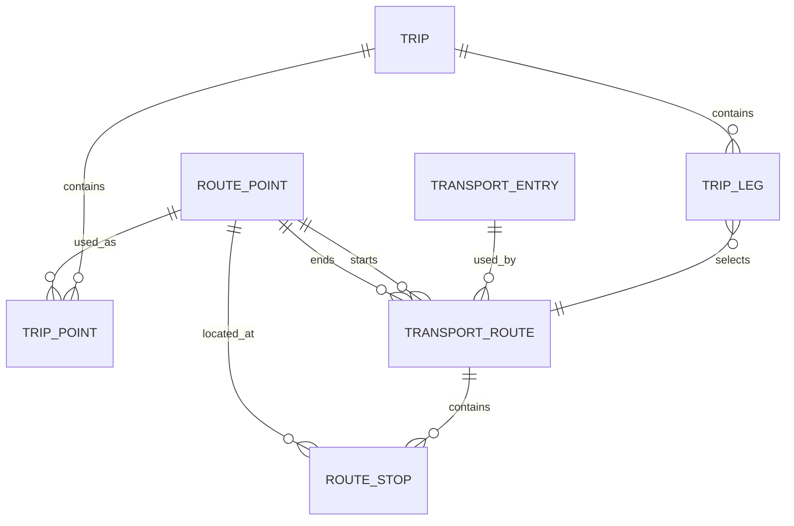

# Trip points, transport entries and routes

## Main branch preservation

The repository's shared/default branch is named `master`. On 2026-10-06, the fetched commit was `7c553673edb2713e2d24eadca101eba5fe652cb0`. Artiom already contains that commit. All 26 tracked files under the original API, Data, Domain and Database source directories are unchanged relative to that commit, including collaborators' models, interfaces, project files and SQL. The single-host Swagger migration retained this work.

| Existing main work | Location | Current status |
| --- | --- | --- |
| User, UserRole, UserStatus and Accomodation models | [Domain models](../src/TravelTracker.Domain/Models) | Christel's work preserved; main has no runnable user/accommodation controller |
| Attraction and TransportMode models | [Domain models](../src/TravelTracker.Domain/Models) | Artiom's original models preserved alongside the current WebApi records |
| User/accommodation/attraction/transport repository interfaces | [Repository interfaces](../src/TravelTracker.Data/Repositories) | Preserved contracts; main has no persistence implementations |
| Trip, settings and map service/repository interfaces | [Services](../src/TravelTracker.Api/Services), [repositories](../src/TravelTracker.Data/Repositories) | James's contracts preserved; Trip/TripLeg/UserSettings/TripMapPoint models and implementations are still missing on main |
| Id64 identifier | [Id64.cs](../src/TravelTracker.Domain/Types/Id64.cs) | Preserved; its existing constructor error blocks the full solution build |
| SQL schema | [schema.sql](../src/Database/schema.sql) | Preserved original schema; no route-point/scheduled-route migration has been applied |

Swagger discovers implemented controllers and their request/response types. A model or interface being present in main does not create an endpoint. The active catalogue runs through [TravelTracker.WebApi](../src/TravelTracker.WebApi); the unfinished shared scaffold remains available for collaborators to continue. [Domain](domain.md), [API](api.md) and [Data](data.md) inventory the retained fields and methods.

The preservation check can be repeated from the repository root:

```powershell
git merge-base --is-ancestor 7c553673edb2713e2d24eadca101eba5fe652cb0 HEAD
git diff --exit-code 7c553673edb2713e2d24eadca101eba5fe652cb0 -- src/TravelTracker.Api src/TravelTracker.Data src/TravelTracker.Domain src/Database
```

Both returned exit code 0. The diff had no output. The [structured verification](milestone-2/implementation/verification.json) records the checked commit and file count under `mainCodeDocumentation`.

## Meaning of each concept

| Concept | Meaning | Dates and relationships |
| --- | --- | --- |
| RoutePoint (implemented) | A reusable named location, with type accommodation, attraction or transport_stop, address and coordinates | No journey dates. Optional sourceId is unverified catalogue metadata. |
| Trip point (planned) | A trip's ordered use of a RoutePoint, such as its start, a reached attraction or a transfer location | Trips may use the same location more than once and keep a saved location snapshot. No TripPoint class or endpoint exists yet. |
| Transport entry (implemented) | A named catalogue entry with code car, bus, train, pedestrian, bike or plane and optional description | Reusable across journeys; has no departure or arrival date. |
| Transport route (planned) | One scheduled journey using one transport entry, a start RoutePoint and a destination RoutePoint | Own departure/arrival and boarding/preparation time; optional ordered intermediate stops. |
| Route stop (planned) | One occurrence of a RoutePoint during a route | Arrival/departure, boarding minutes and permission to leave the vehicle. |
| Trip and TripLeg (planned) | The complete itinerary and one ordered selected journey within it | Trips owns user/privacy, route connections, trip dates, stays, visits and an atomic save. |

A transport entry is not a route, and a location is not a schedule. Multiple routes can use the same transport entry or location. Repeated visits to a location are separate occurrences rather than new physical places.

## Relationships



The diagram describes the future integration. Only RoutePoint and transport entries, plus Attractions, have current GET-by-ID/POST endpoints. Scheduled routes were removed when the human requested the simple implementation; they remain future work. This update preserves main code and documents the relationships without restoring scheduling or adding new models/endpoints. These are logical relationships, not deployed SQL foreign keys.

A future scheduled-route contract would identify the transport entry, start/destination route points and each intermediate stop's point. The Trips service would select the route for a leg, associate that leg with its ordered trip-point occurrences, and save the chosen transport/location details as snapshots. The trip would stay readable if a catalogue changed or became unavailable. Final field names, ID conversions between the GUID catalogue and Id64 Trips contracts, and cross-owner validation still need review before implementation.

Accommodation and attraction points can carry a sourceId for the corresponding place catalogue. Transport-stop points can stand alone. The current API merely stores that optional GUID; it does not verify a source record or keep its fields synchronized. An accommodation point therefore does not create an Accomodation entity, and an attraction point does not create an Attraction entity.

## Planned timing rules

Times belong to a specific journey or point occurrence. Creating a transport entry such as a bus or bike does not schedule a journey.

- A scheduled route supplies departure/arrival times and nonnegative boarding/preparation minutes. Preparation applies to every mode: reaching a bus, station/airport checks, or finding and preparing a bike. Exact values are entered rather than inferred from the mode.
- Intermediate stops are ordered, have arrival/departure times inside the route, and can repeat a location. Arrival must not follow departure; stop times and route legs must advance without overlap.
- The traveller must allow preparation before departure. The future editor follows the trip time-zone rules in [Design](design.md) and must clarify ambiguous local times.
- A stop's downtime is departure minus arrival. Potential free time subtracts preparation when leaving the vehicle is allowed. A future attraction suggestion must also fit travel out, the visit, return and buffers. Nothing is added automatically.

These rules are documented for later implementation; the current GET/POST catalogue performs no timing calculations.

## Example

- P1: accommodation, Hotel.
- P2: transport_stop, Station.
- P3: attraction, Museum.
- T1: bus, Example Bus.
- R1 (future): uses T1, starts at P1, ends at P3, with P2 as an intermediate stop; departure, arrival and preparation belong to R1 and its stop.

A future trip can select R1 as an itinerary leg and add visits/stays around it. Its global accommodation-to-attraction or round-trip rules remain owned by Trips. A transport-stop point can be a route endpoint or intermediate transfer; it does not automatically become the entire trip's start or destination.

## API and persistence boundaries

The human selected one host and Swagger page like LAB_07. Resource controllers remain separate while sharing http://localhost:5104. Catalogue storage is in-memory and resets on restart. The original API/Data/Domain projects remain in [TravelTracker.slnx](../TravelTracker.slnx), without a dependency from WebApi. Their declared methods are not replaced by the simple WebApi interfaces.

The main SQL Trips row currently stores one departure/destination directly; ordered trip legs, route references, point snapshots and intermediate stop occurrences need a later reviewed database migration. The original SQL mode enum also lacks bike, which the current in-memory catalogue supports. No schema or collaborator source was modified here.

See [API contracts](api.md), [domain records](domain.md), [data status](data.md) and [implementation evidence](milestone-2/implementation/validation.md).
